# 3DS Homebrew

Original games for the Nintendo 3DS, written in C with [devkitPro](https://devkitpro.org/) (libctru, citro2d, citro3d).
They run on real hardware (most in stereoscopic 3D), and each one has a PC harness that renders preview frames and
runs logic tests without a console.

**[⬇ Download the latest release](https://github.com/ricozama121803/3ds-homebrew/releases/latest)** (`.cia` and `.3dsx` for every game)

| Game | | Download |
| --- | --- | --- |
| [**BeatPad**](#beatpad) | Rhythm game: turn any song into a chart with Song Studio and send it over Wi-Fi | [cia](https://github.com/ricozama121803/3ds-homebrew/releases/latest/download/beatpad.cia) · [3dsx](https://github.com/ricozama121803/3ds-homebrew/releases/latest/download/beatpad.3dsx) |
| [**Grand Theft Otto II**](#grand-theft-otto-ii) | Fully 3D crime sandbox in a small LA: mocap-animated characters, cars, bikes, helicopters, planes, cover shooting | [cia](https://github.com/ricozama121803/3ds-homebrew/releases/latest/download/grandtheftotto2.cia) · [3dsx](https://github.com/ricozama121803/3ds-homebrew/releases/latest/download/grandtheftotto2.3dsx) |
| [**Web Slinger**](#web-slinger) | Web-swinging through a procedural Manhattan with pendulum physics, wall runs and a wingsuit | [cia](https://github.com/ricozama121803/3ds-homebrew/releases/latest/download/webslinger.cia) · [3dsx](https://github.com/ricozama121803/3ds-homebrew/releases/latest/download/webslinger.3dsx) |
| [**Grand Theft Otto**](#grand-theft-otto) | Open-world LA with a real 3D city, day/night, eight weapons, cars and helicopters | [cia](https://github.com/ricozama121803/3ds-homebrew/releases/latest/download/grandtheftotto.cia) · [3dsx](https://github.com/ricozama121803/3ds-homebrew/releases/latest/download/grandtheftotto.3dsx) |
| [**Sunset Ops**](#sunset-ops) | First-person 4 vs 4 team deathmatch against bots on a desert cul-de-sac | [cia](https://github.com/ricozama121803/3ds-homebrew/releases/latest/download/sunsetops.cia) · [3dsx](https://github.com/ricozama121803/3ds-homebrew/releases/latest/download/sunsetops.3dsx) |
| [**Tuffy Run**](#tuffy-run) | Endless runner through the Cal State Fullerton campus | [cia](https://github.com/ricozama121803/3ds-homebrew/releases/latest/download/tuffyrun.cia) · [3dsx](https://github.com/ricozama121803/3ds-homebrew/releases/latest/download/tuffyrun.3dsx) |
| XMB Launcher | A PS3-style launcher for your homebrew | [3dsx](https://github.com/ricozama121803/3ds-homebrew/releases/latest/download/xmb-launcher.3dsx) |

## Getting started

You need a 3DS (any model) with custom firmware: [Luma3DS](https://3ds.hacks.guide/), which also gives you **FBI**
(installs `.cia` files) and the **Homebrew Launcher** (runs `.3dsx` files).

1. **Download** a game's `.cia` from the [latest release](https://github.com/ricozama121803/3ds-homebrew/releases/latest).
2. **Install it**, one of three ways:
   - **SD card:** copy the `.cia` to the SD card (for example into a `cias` folder), then on the 3DS open
     **FBI → SD → cias → the file → Install CIA**. It appears on the HOME Menu.
   - **Wi-Fi, no SD card swapping:** open **FBI → Remote Install → Receive URLs over the network** on the 3DS, then on
     your PC run `./install-cia.sh <project> <3ds-ip>` from this repo (FBI shows the IP).
   - **No install:** copy the `.3dsx` to `sdmc:/3ds/` and start it from the Homebrew Launcher.
3. **Sound:** games with music use the 3DS's DSP, which needs `sdmc:/3ds/dspfirm.cdc`. Run the
   [DSP1](https://github.com/zoogie/DSP1/releases) homebrew once to create it.
4. Move the **3D slider** up: the 3D games render both eyes.

## BeatPad

| | |
| --- | --- |
| 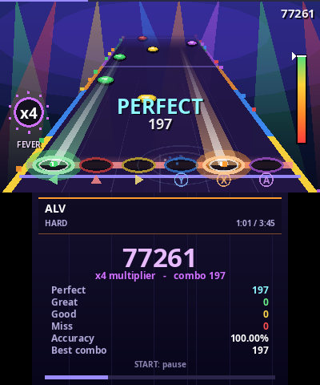 | 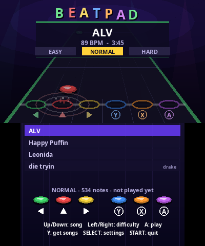 |
| 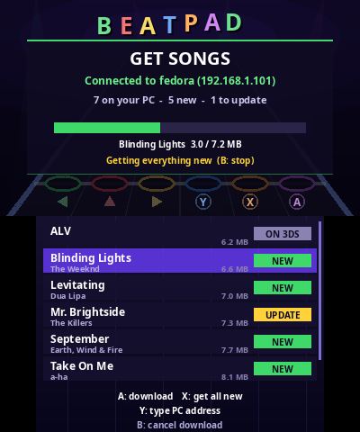 | 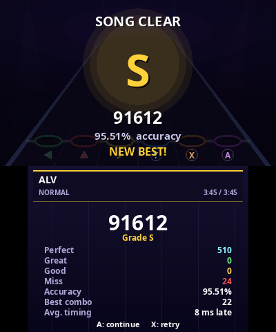 |

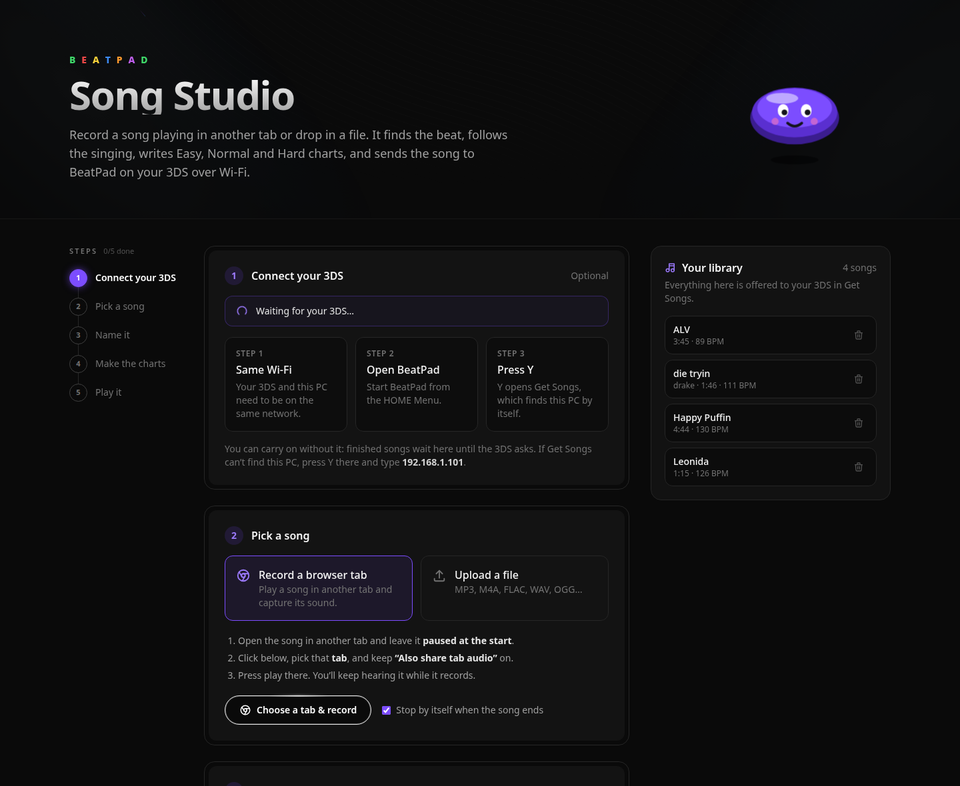

Hit notes on the beat with **D-pad Left / Up / Right** and **Y / X / A**. Charts follow the singing: Song Studio on your
PC separates the vocals with Demucs, places notes on the sung syllables (snapped to a drum-locked beat grid), turns long
sung notes into holds and makes the lanes follow the melody. Hit beams, shockwave rings, beat-synced flashes and a
x4 FEVER mode. Songs travel to the 3DS over Wi-Fi (**Y → Get Songs**).

**Add songs:** `cd beatpad && ./serve-songs.sh`, open http://localhost:47330, record a browser tab or upload a file.
Details, setup and how charting works: [`beatpad/README.md`](beatpad/README.md).

## Grand Theft Otto II

| | |
| --- | --- |
| 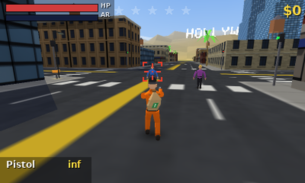 | 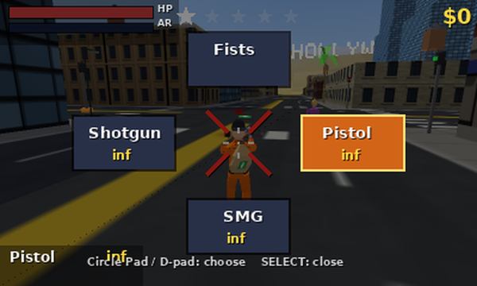 |
| 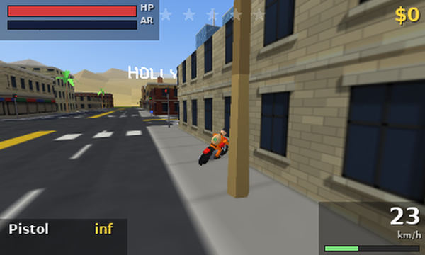 | 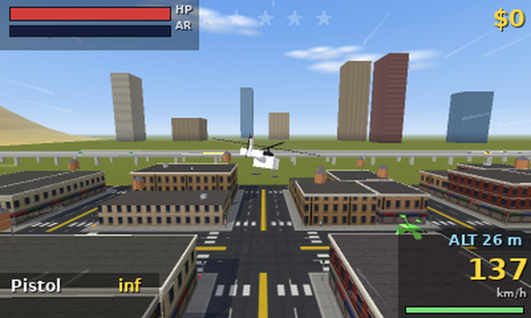 |
| 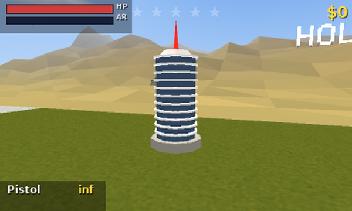 | 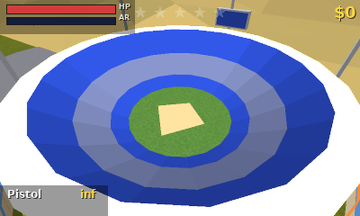 |
| 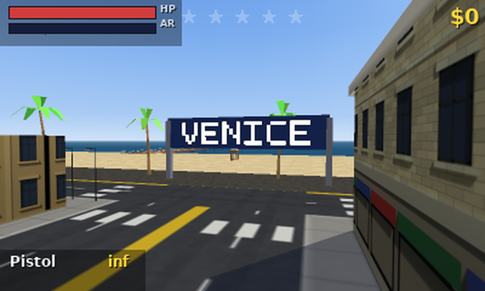 | 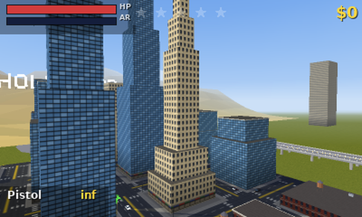 |

Fully 3D third-person sandbox in a small LA (city, airport and Sunset Hills regions): Blender-made, rigged and
mocap-animated Otto, pedestrians and cars; traffic with lights, crowds, cops and a 1–5 star wanted level; guns with a
weapon wheel, L lock-on, cover and punches; motorcycles, helicopters, planes and parachutes; a pier with a Ferris wheel,
the HOLLYWOOD sign, Capitol Records, Dodger Stadium, the LAX Theme Building, Randy's Donuts and City Hall.
Plan and controls: [`grand-theft-otto-2/PLAN.md`](grand-theft-otto-2/PLAN.md).

## Web Slinger

| | |
| --- | --- |
| 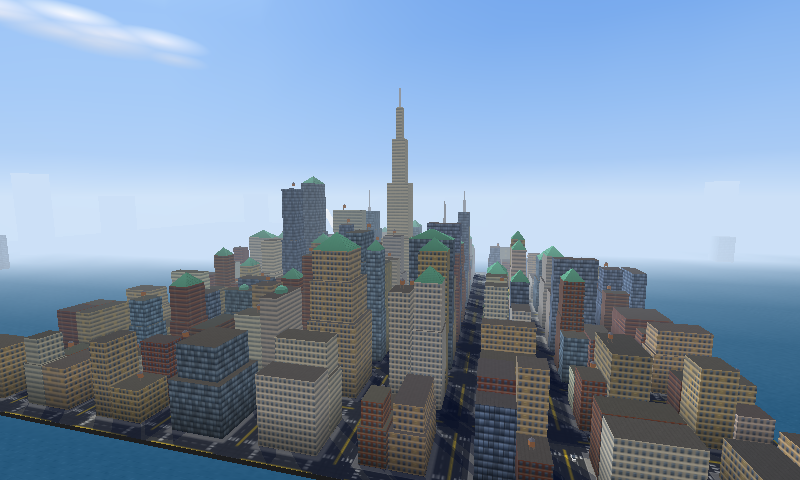 | 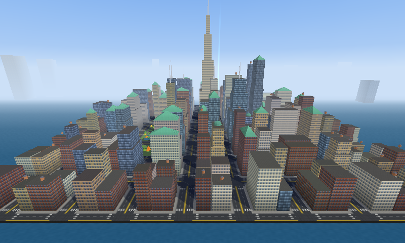 |
| 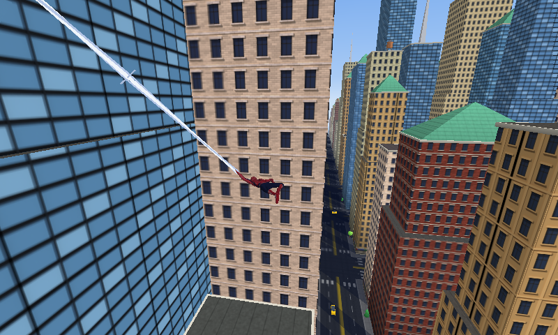 | 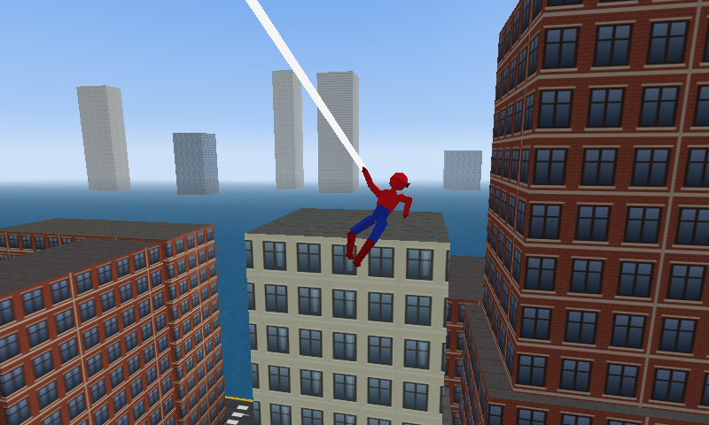 |
| 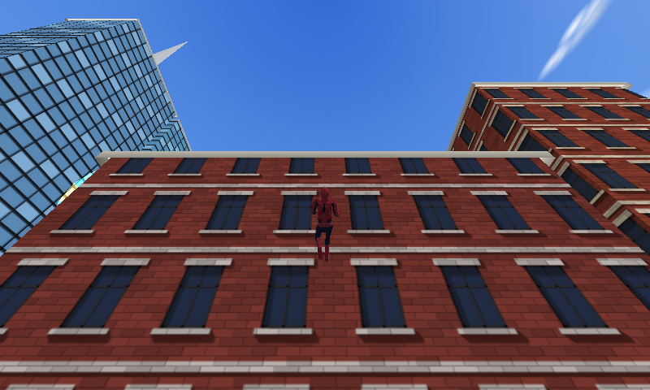 | 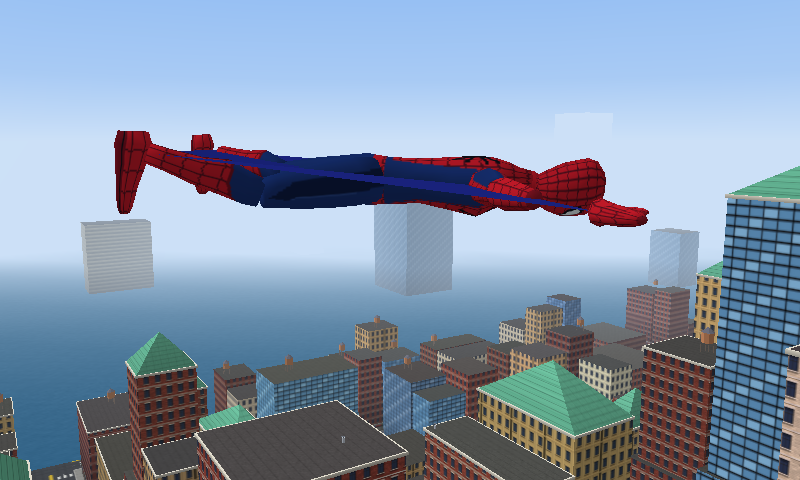 |

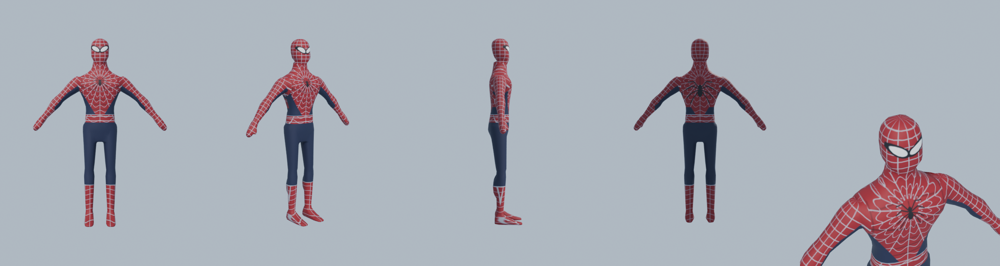

Web-swinging through a procedural Manhattan (15×15 blocks, a stepped landmark tower, park, water and traffic).
**R** holds a web swing (pendulum physics), **A** jumps / lets go with a boost, run into a building to climb it
(hold **L** to run up the facade), **L + R** web-zips to a roof, tap **L** in the air for the wingsuit, **B** dives.
Free Roam and a timed Beacon Run. The hero is one skinned mesh driven by motion-capture run cycles.

## Grand Theft Otto

| | |
| --- | --- |
| 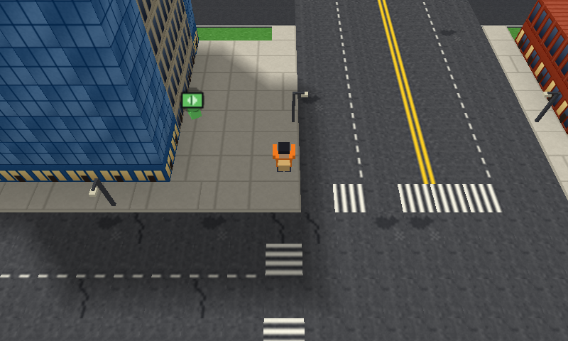 | 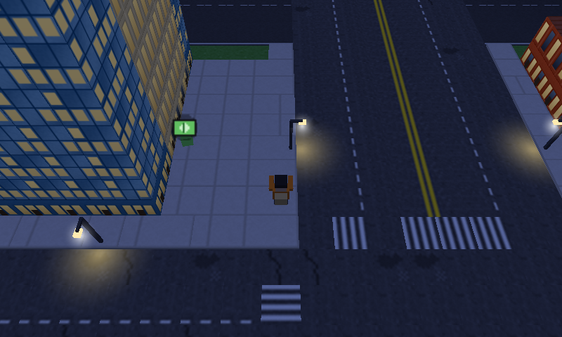 |
| 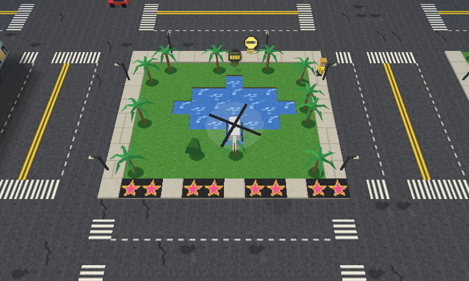 | 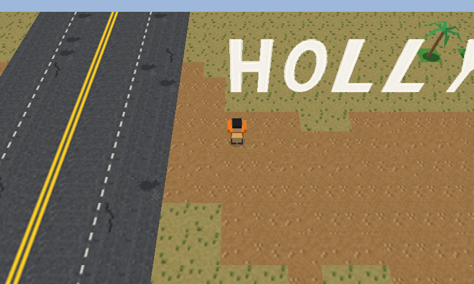 |

Open-world crime sandbox in a 256×256-tile LA with a real 3D city: extruded buildings, baked sun shadows and a
day/night cycle, eight weapons, cars and helicopters. Pause + **X** switches to a classic top-down view.
Notes: [`grand-theft-otto/PLAN.md`](grand-theft-otto/PLAN.md).

## Sunset Ops

| | |
| --- | --- |
| 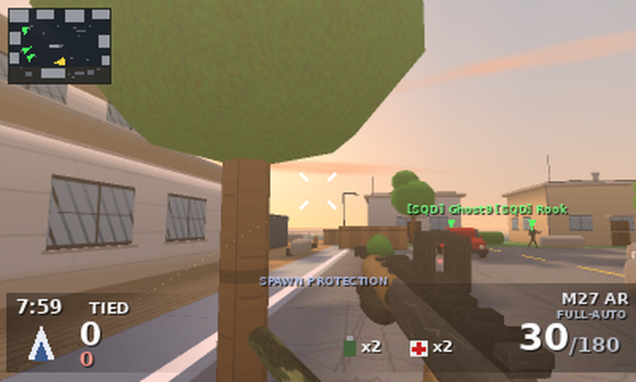 | 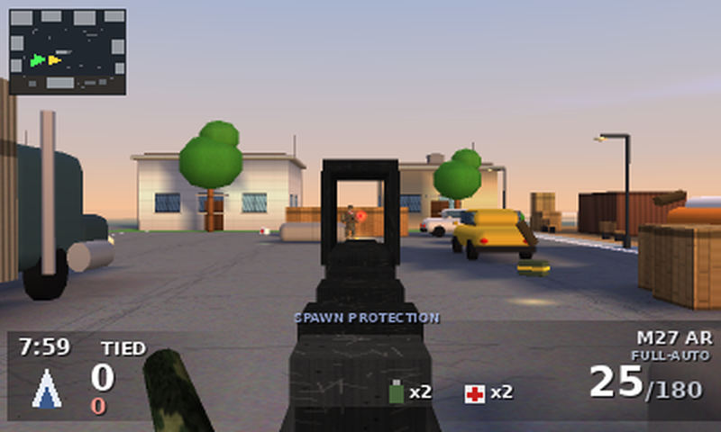 |
| 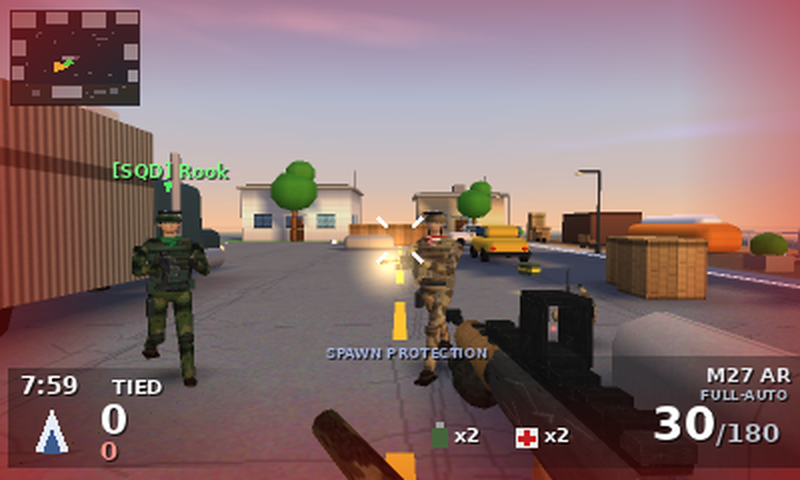 | 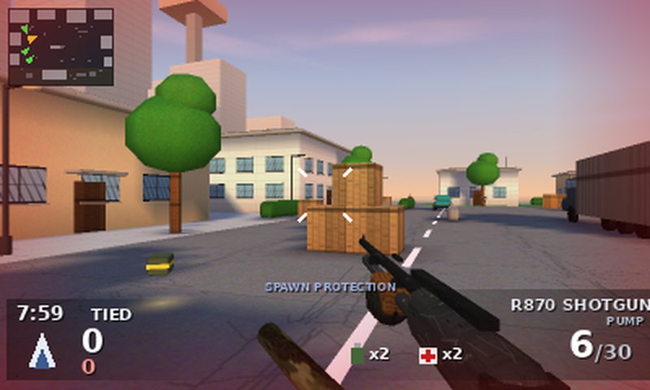 |

First-person 4 vs 4 team deathmatch against bots on a suburban cul-de-sac in the desert, with two enterable houses.
**X/Y/A/B** move, **Circle Pad** looks, **R** shoots, **L** aims down red-dot sights, **D-pad** switches weapon,
throws a grenade or heals. Radar and kill feed. Notes: [`sunset-ops/PLAN.md`](sunset-ops/PLAN.md).

## Tuffy Run

| | |
| --- | --- |
| 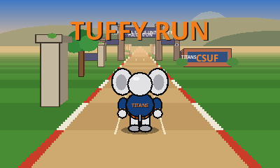 | 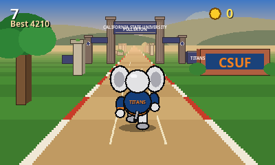 |
| 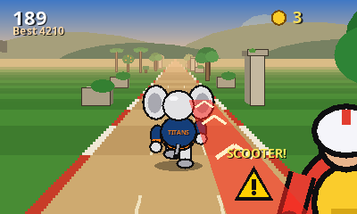 | 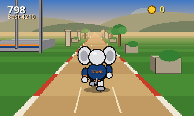 |

Endless runner as Tuffy the Titan through Cal State Fullerton landmarks. Swipe or use the **D-pad** to change lanes,
**A** / swipe up jumps, **B** / swipe down slides, and watch for scooters coming from behind. High score on the SD card.

## Build from source

Toolchain: devkitPro with the `3ds-dev` package (`bash setup.sh` on Debian/Ubuntu, then `source env.sh`). Without a
local install, `./dkp-make.sh <project>` builds in the official `devkitpro/devkitarm` container (podman or docker) and
packages the `.cia` on the host.

```bash
./dkp-make.sh beatpad             # → beatpad/beatpad.3dsx and beatpad.cia
./install-cia.sh beatpad          # send it to FBI's Remote Install over Wi-Fi
```

`makerom` and `bannertool` (for `.cia` files) go in `tools/bin/` (git-ignored): build them from
[Project_CTR](https://github.com/3DSGuy/Project_CTR) and [bannertool](https://github.com/Steveice10/bannertool).

**PC previews and tests:** each game's `host/` folder compiles its logic and drawing with `gcc` against a small software
rasteriser, e.g. `grand-theft-otto-2/host/preview.sh out/` renders frames to PNG and `host/simtest.c` runs headless checks.

## Repository layout

```
beatpad/              rhythm game + Song Studio (studio/), song tools (tools/), PC tests (host/)
grand-theft-otto-2/   3D sandbox; Blender model pipeline in assets/ (`make models`)
grand-theft-otto/     first open-world game (3D city + top-down view)
webslinger/           web-swinging game; hero mesh pipeline in assets/hero (`make hero`)
sunset-ops/           first-person shooter
tuffyrun/             endless runner
xmb-launcher/         PS3-style homebrew launcher
homemenu-mod/         scripts for patching the HOME Menu theme layouts (the extracted Nintendo files stay local)
hello3ds/             minimal starter app
docs/                 screenshots used in these READMEs
dkp-make.sh           build a project in the devkitARM container
install-cia.sh        install a .cia over Wi-Fi with FBI
setup.sh, env.sh      local devkitPro install
```

Each game keeps its logic separate from drawing so it runs on the PC; sprites, textures and models are generated by
scripts in each project's `assets/` folder.

Made by [Enrico Zamarripa](https://enrico-zamarripa-portfolio-site.vercel.app). Not affiliated with Nintendo.
