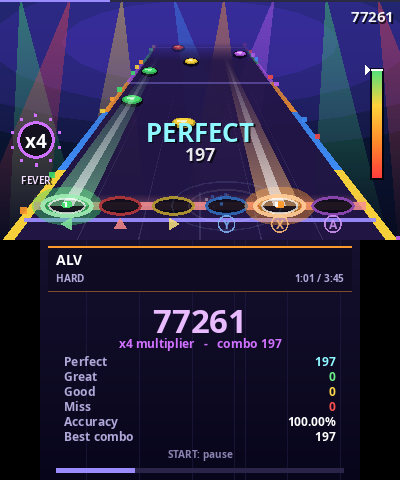
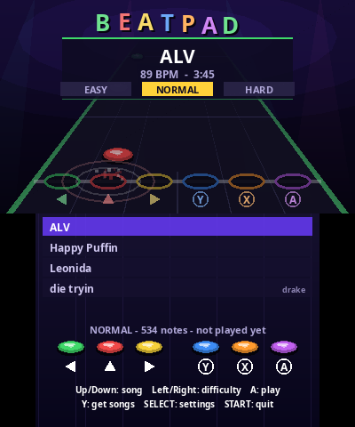
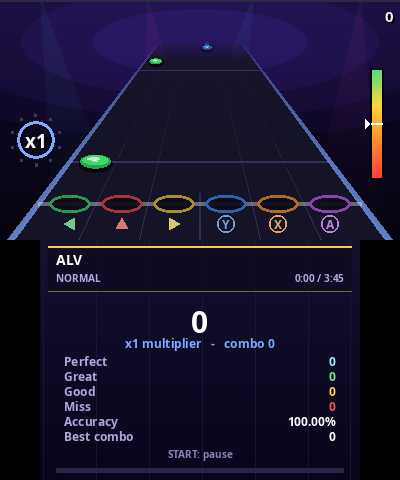
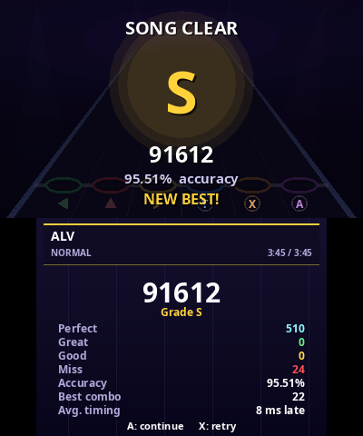
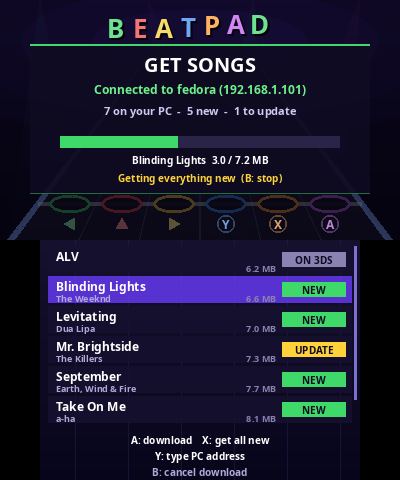
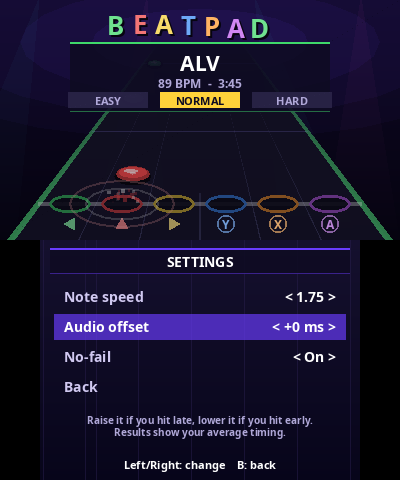
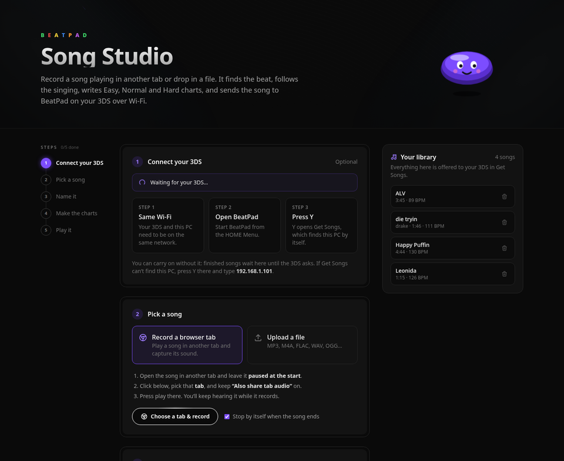

# BeatPad

A rhythm game for the Nintendo 3DS. Notes scroll down a highway and you hit them on the beat with the D-pad and face
buttons. Any song becomes a chart: **Song Studio** on your PC records a song from a browser tab (or takes a file),
finds the beat, follows the singing, writes Easy / Normal / Hard charts and sends the song to your 3DS over Wi-Fi.

| | |
| --- | --- |
|  |  |
|  |  |
|  |  |



*Game frames come from the PC preview renderer (`host/preview.sh`), which runs the game's own drawing code.*

## Play

**Lanes:** D-pad **Left / Up / Right** and **Y / X / A**. Easy uses four lanes (Left, Right, Y, A); Normal and Hard use all six.

- Hit a note as it crosses the line: **Perfect / Great / Good** (±45 / 85 / 125 ms). Hold the button through a hold note's tail.
- Every 10 notes in a row raise the multiplier, up to **x4 (FEVER)**. After 10 in a row the strike line flashes on the beat.
- The rock meter on the right drops when you miss; with No-fail off, an empty meter ends the song.
- **Song select:** Up/Down picks a song, Left/Right the difficulty, A plays, Y opens **Get Songs**, SELECT opens settings.
- **Settings:** note speed, audio offset (the results screen shows your average timing: raise the offset if you're late), No-fail.
- Best scores, grades and settings are saved to `sdmc:/3ds/beatpad.txt`.

Sound needs the DSP firmware dump (`sdmc:/3ds/dspfirm.cdc`, made once with the DSP1 homebrew).

## Add songs

BeatPad doesn't ship with songs: you make them from music you have.

1. On your PC, in this folder: `./serve-songs.sh` (needs Python 3, ffmpeg, Node.js for the first run, and the Demucs
   setup below). Then open **http://localhost:47330**.
2. Follow Song Studio's steps: **record a browser tab** (Chrome/Edge: play the song in another tab; recording stops by
   itself when it ends) or **upload a file**, give it a title, and press **Make the charts**. It takes a few minutes.
3. On the 3DS, press **Y** on the song select (Get Songs). It finds your PC by itself, lists new songs as they finish,
   and **A** downloads one (X gets everything new). Downloaded songs live in `sdmc:/3ds/beatpad/songs/`.

From a terminal instead: `./add-song.sh song.mp3 [more files or folders]` converts and then shares the songs.

**One-time setup** (vocal separation): from the repo root,

```bash
python3 -m venv tools/venv
tools/venv/bin/pip install torch torchaudio --index-url https://download.pytorch.org/whl/cpu
tools/venv/bin/pip install demucs soundfile
```

## How charts are made

`tools/make_song.py` (numpy + ffmpeg):

1. **Beat grid**: tempo from the onset autocorrelation, then every drum hit is matched to the grid with ~3 ms precision
   and a weighted line fit gives the exact tempo and phase; small real tempo changes are followed section by section.
2. **Vocals**: [Demucs](https://github.com/facebookresearch/demucs) splits the singing from the music (its 23 ms decoder
   delay is measured and removed). A YIN pitch tracker and loudness re-attacks cut the vocal track into sung notes.
3. **Notes**: sung syllables within 45 ms of the 16th grid snap onto it; strong beats score higher; each two-bar section
   gets a share of the note budget from its loudness; long sung notes become holds; where nobody sings, kicks go to the
   left hand and snares to the right. Lanes follow the sung melody.
4. **Audio**: 32 kHz stereo IMA-ADPCM (`tools/bpa.py`, a quarter of raw PCM, ~7 MB a song), decoded on the 3DS while it
   streams through the DSP. The note clock follows the DSP's play position.

## Code

| Path | What it is |
| --- | --- |
| `source/main.c` | Screens, input, the song clock, saves, Get Songs |
| `source/game.c` | Judging, scoring, multiplier, rock meter, hit effects state (no 3DS calls: runs on the PC too) |
| `source/render.c`, `draw.h` | Highway, notes, effects and menus (citro2d shapes) |
| `source/audio.c`, `bpa.c` | NDSP streaming and the ADPCM decoder |
| `source/net.c` | Finds the PC (UDP broadcast) and downloads songs (HTTP), on a worker thread |
| `source/song.c` | Loads songs from romfs and `sdmc:/3ds/beatpad/songs` |
| `tools/songs.py` | Song library, the 3DS song server and Song Studio's API |
| `tools/make_song.py`, `vocals.py`, `bpa.py` | Charting, vocal note detection, audio encoder |
| `studio/` | Song Studio (Next.js, React, Tailwind, Aceternity UI); `npm run dev` for hot reload |
| `host/` | PC tests and frame previews: `simtest.sh` (judging + every chart in `library/`), `bpatest.c` (decoder), `nettest.c` (discovery + download), `preview.sh` |

Build with `../dkp-make.sh beatpad` (or `make` with devkitPro). Install over Wi-Fi with `../install-cia.sh beatpad`.
